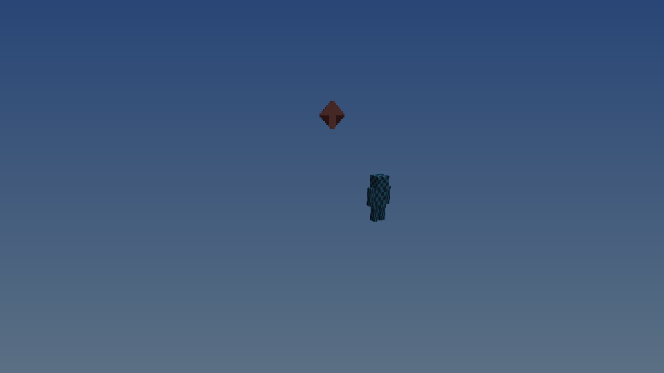
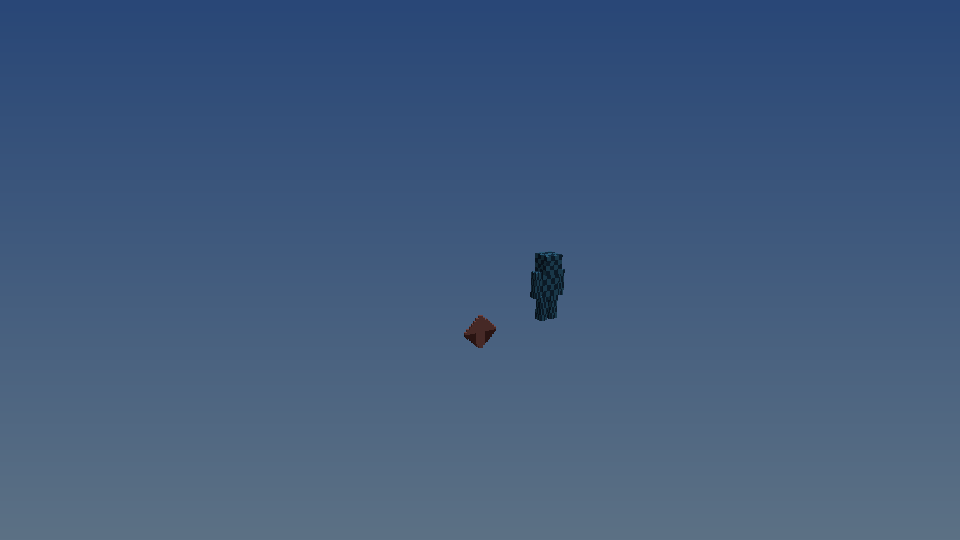

# 07 · Animate a bouncing display

`entityByUUID<ItemDisplay>` locates the display just summoned. It starts with a Y offset of 4. Each callback passes `(frame + 1) / 50.0` to `bounce` and writes the new height to `display.transform.y`. Frame 49 performs the final write before returning `false` to stop.

```mcfpp
    const display = entityByUUID<ItemDisplay>(UUID("0-0-0-0-49"))
    display.transform.y = 4.0
    tick { frame ->
        var progress = (frame + 1) / 50.0
        display.transform.y = (1.0 - bounce(progress)) * 4.0
        return frame < 49
    }
```

## Try it

In IDEA, choose **Run (Render)** beside `main`, then **Play** to watch the stone fall and bounce. Compare the timers in `timers`. `loop(10)` executes its callback at indices 0, 1 and 2, while `schedule(20)` runs once after 20 ticks. The `bounceEndpoints` test checks that the curve starts at `0.0` and ends at `1.0`.

These two DSB renders from the example use the same camera. Compare the display’s height with the stationary player on the right.

| Initial state | After 50 ticks |
| --- | --- |
|  |  |

The in-game entry point is `/function showcase.animation:main`.

[Full source](https://github.com/MinecraftFunctionPlusPlus/MCFPP_Example/blob/8f39d3921157404c642f1613fa40811f35213761/07-display-animation/src/main/mcfpp/main.mcfpp) · [Tests](https://github.com/MinecraftFunctionPlusPlus/MCFPP_Example/blob/8f39d3921157404c642f1613fa40811f35213761/07-display-animation/src/test/mcfpp/animation_test.mcfpp)
