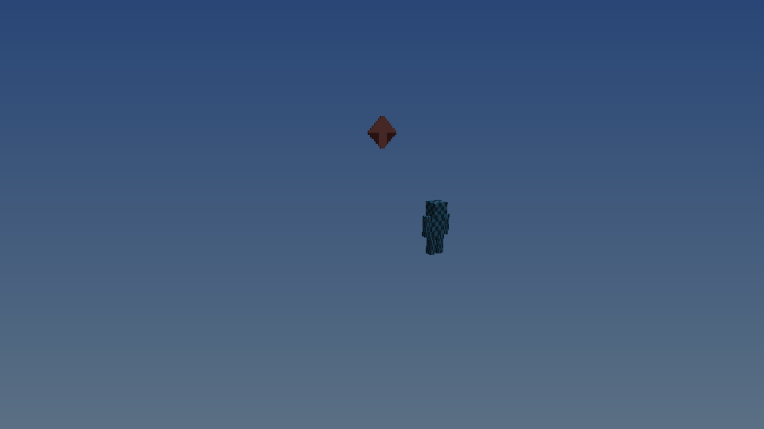
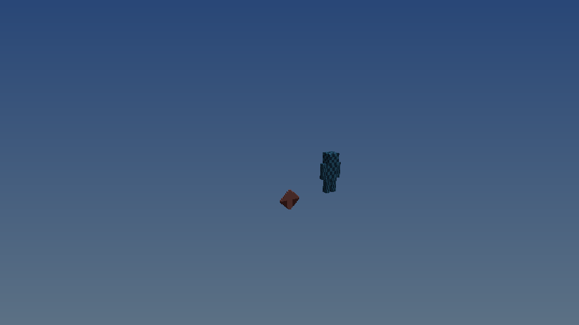

# 07 · 逐 tick 播放弹跳动画

`entityByUUID<ItemDisplay>` 取到刚召唤的展示实体。初始 Y 偏移为 4，每一帧把进度 `(frame + 1) / 50.0` 代入 `bounce`，再将高度写回 `display.transform.y`。第 49 帧仍写入高度，随后回调返回 `false`，结束动画。

```mcfpp
    const display = entityByUUID<ItemDisplay>(UUID("0-0-0-0-49"))
    display.transform.y = 4.0
    tick { frame ->
        var progress = (frame + 1) / 50.0
        display.transform.y = (1.0 - bounce(progress)) * 4.0
        return frame < 49
    }
```

## 动手验证

在 IDEA 的 `main` 旁选择 **Run (Render)**，点击 **Play**，观察石头从高处落下并弹跳。若要比较调度方式，打开 `timers`：`loop(10)` 的回调在索引 0、1、2 各执行一次，`schedule(20)` 延迟 20 tick 执行一次。测试 `bounceEndpoints` 检查曲线两端分别为 `0.0` 和 `1.0`。

下图是示例仓库用 DSB 导出的同一视角。对照右侧固定的玩家，可以看到展示实体的高度变化。

| 初始状态 | 第 50 tick |
| --- | --- |
|  |  |

游戏入口为 `/function showcase.animation:main`。

[完整源码](https://github.com/MinecraftFunctionPlusPlus/MCFPP_Example/blob/8f39d3921157404c642f1613fa40811f35213761/07-display-animation/src/main/mcfpp/main.mcfpp) · [测试](https://github.com/MinecraftFunctionPlusPlus/MCFPP_Example/blob/8f39d3921157404c642f1613fa40811f35213761/07-display-animation/src/test/mcfpp/animation_test.mcfpp)
